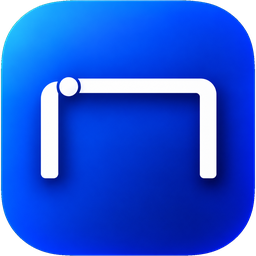
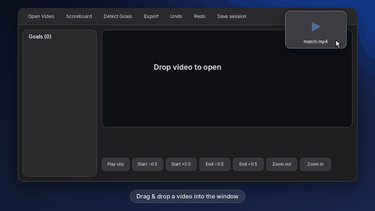
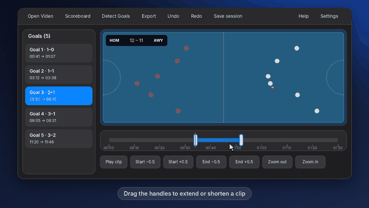
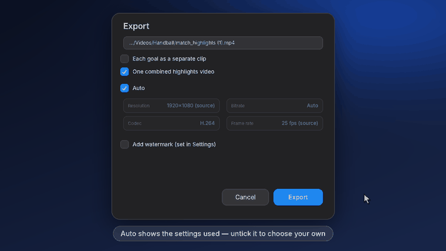

<h1 align="center">Handball Highlights Maker</h1>

Turn a full handball match recording into its highlights — automatically. Free for Windows · works offline  Tunation

---

  
  
  
  

  <a href="#features">Features</a> ·
  <a href="#download">Download</a> ·
  <a href="#quick-start">Quick start</a> ·
  <a href="#default-keyboard-shortcuts">Shortcuts</a> ·
  <a href="#frequently-asked-questions">FAQ</a>

---

## What it does

Handball Highlights Maker turns a full handball match recording into its highlights.
Drop a match video into the app and draw a box around the on-screen scoreboard. Handball Highlights Maker reads the score, finds every goal, and cuts a clip around each one. You can then fine-tune every clip and export the goals as separate clips and/or one combined highlights video — with elegant transitions and your own watermark if you like.
 The application can also be used on any scoreboard game besides Handball (ex: Basketball, Volleyball...), but it is more suited for Handball.

## Features

- **Automatic goal detection** from the scoreboard — works with any broadcast layout (you draw one box around the whole scoreboard and can check it with **Test reading**).
- **Careful with real matches:** the app copes with replays that hide the scoreboard (the missing goals are added and marked ⚠ with an estimated time), operator corrections, cancelled goals and misread digits, and tells you at the end whether every goal in the score is accounted for. A detailed report is saved for each detection.
- **Precise manual editing:** drag the clip handles, nudge by ±0.5 s (click & hold to repeat), zoom the timeline, scrub by dragging the yellow cursor, with the mouse wheel or with the ← / → keys.
- **Reorder goals** by drag & drop, double-click to play a clip, add clips the app missed.
- **Undo / Redo** and **saved sessions** — pick up your editing exactly where you left off.
- **Export your way:** each goal separately, one combined video, or both. Automatic quality, or choose resolution, bitrate, codec and frame rate.
- **Transitions:** none, fade through black, or dissolve.
- **Watermark:** place, resize and crop your logo on a virtual screen; it is applied identically at any video resolution.
- **Live progress:** while detecting goals you see the goals found so far and how far into the video the app has got — press **Stop** to keep what was found. Exporting shows which goal is being processed.
- **Video information:** click the **Video info** button (or press `Ctrl+I`) for duration, resolution, frame rate, codecs, bitrate and more.
- **Presets, themes, custom shortcuts:** dark (default) or light theme, every shortcut can be changed, settings can be saved as presets.
- **Offline & private:** your videos never leave your PC.

## Download

Go to the **[Releases](../../releases/latest)** page and download the latest `Handball-Highlights-Maker-…-Windows.zip`.

1. Unzip it anywhere (keep all the files together in the folder).
2. Run **`Handball Highlights Maker.exe`**.

No installation and no separate programs are needed. In the app, **Help → Check update** (`F5`) tells you when a new version is available and can **update the app for you in one click**.

> **Windows SmartScreen:** because the app is new and not code-signed, Windows may show *"Windows protected your PC"*. Click **More info → Run anyway**.

## Quick start

1. **Open a video** — drag it into the window or click *Open Video*.
2. **Draw a box** around the whole scoreboard (both team names, both scores and the clock) with a little margin, then click **Test reading** to see what the app reads.
3. Wait while the goals are detected, then select any goal in the list and adjust its start/end if needed.
4. Click **Export**.

The full illustrated manual is inside the app: **Help → How to**.

## Default keyboard shortcuts

| Action | Shortcut | Action | Shortcut |
|---|---|---|---|
| Open video | `Ctrl+O` | Add clip at playhead | `A` |
| Draw scoreboard box | `Ctrl+B` | Delete clip | `Del` |
| Detect goals | `Ctrl+D` | Delete all goals | `Ctrl+Shift+D` |
| Export | `Ctrl+E` | Undo / Redo | `Ctrl+Z` / `Ctrl+Y` |
| Open settings | `Ctrl+Space` | Save session | `Ctrl+S` |
| Check update | `F5` | Play / pause | `Space` |
| How to (manual) | `F1` | Play selected clip | `P` |
| About | `F2` | Previous / next clip | `↑` / `↓` |
| Start earlier / later (0.5 s) | `Ctrl+←` / `Ctrl+→` | End earlier / later (0.5 s) | `Alt+←` / `Alt+→` |
| Video information (or the **Video info** button) | `Ctrl+I` | Move playhead back / forward (1 s) | `←` / `→` |

All shortcuts can be changed in **Settings → Shortcuts**.

## Tips

- The scoreboard on TV usually updates a little *after* the goal, so clips start 20 s before the detected score change by default. Change this in Settings.
- If goals are missed or wrong, use **Test reading** to check the scoreboard box, read the detection summary (⚠ marks goals whose time is only estimated) and add or adjust clips manually.
- Dissolve transitions with 50+ clips can be slow; *Fade through black* is much lighter.

## Frequently asked questions

**Is it really free ?** Yes — see the license below.
 **Does it upload my videos ?** No. Everything runs on your computer. The only network access is *Check update* (and downloading the new version if you choose to update).
 **Which video formats work ?** MP4, MKV, MOV, AVI, TS, M4V, WMV and WebM.
 **Where are my settings stored ?** In `%APPDATA%\HandballHighlightsMaker\` (settings, presets and your saved session).
 **Mac / Linux?** Not available yet.
 **Can it be used for other scoreboard games (ex: Basketball, Volleyball...) ?** Yes. It can also be used on any scoreboard game besides Handball, but it is more suited for Handball.

## Feedback & bugs

Found a bug or have an idea? Open an **[Issue](../../issues)** and, if you can, attach a screenshot of the scoreboard and the video resolution.

## License

Handball Highlights Maker is **free software for you to use, but it is not open source**. You may use it free of charge, including to make videos you publish or sell, but you may not copy, modify, resell or redistribute the app. See [LICENSE](LICENSE) for the full terms and [THIRD_PARTY_NOTICES.md](THIRD_PARTY_NOTICES.md) for the open-source components it uses.

## Author

**Khaled Z.** — Tunisia 🇹🇳 · [github.com/Khaled-Z-cloud](https://github.com/Khaled-Z-cloud/)
